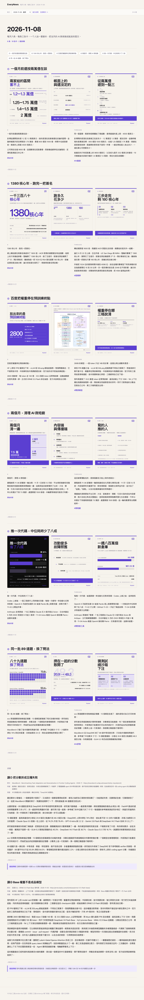

# EveryNews

One local pipeline turns each day's AI news into a ready-to-post package: six stories, three 1080×1350 portrait cards each, with an X main post, Threads copy, a fact sheet, and two explainer essays, then one single-file webpage that opens from a URL.

[中文](README.md) | **English**

[What it does](#what-it-does) · [Why use it](#why-use-it) · [Quick start](#quick-start) · [Browse by date](#browse-by-date) · [Put it on your own GitHub Pages](#put-it-on-your-own-github-pages) · [Make it your own](#make-it-your-own) · [What's verified](#whats-verified) · [Known limitations](#known-limitations) · [Directory](#directory)



## What it does

Run one production pass and you get:

| Output | Description |
|---|---|
| 18 portrait cards | Six stories × three cards, 14 layouts; the six lead images are deduped automatically so the layouts don't collide |
| X main post + Threads copy | Traditional Chinese, zero colons and zero dashes. X main post 120–200 characters; the Threads target in the rule sheet is 150–250, and the gate accepts 120–260 |
| Fact sheet | One table per story, with time, subject, figures, sources, and unconfirmed boundaries written out line by line |
| Explainer essays | Two pieces, 600–900 Chinese characters (han count), clear enough to read and then do |
| Single-file public page | Images fully inlined; drop one HTML file on any static host and it is reachable |
| All-issues archive | `index.html` filters past issues by issue, exact date, or title keyword |

## Why use it

- **Rule-driven, stable voice.** What to write, how to write it, and what to hand off all live in one rule sheet, so whoever runs it gets the same flavor.
- **Gated checks.** Character-count ranges, colons and dashes, source tiers, layout dedup, and most reversal phrasing are checked automatically. Fail the gate and no draft goes out.
- **One command for the package.** Rendering, the public page, the archive index, the full-page preview, the gate, the ledger, and the handoff docs all finish in a single run.
- **Runs entirely locally.** node + python + playwright, no cloud dependency, and the output stays yours.

## Quick start

Prerequisites: node 20+, python3, playwright-cli (used for card screenshots and the full-page preview).

```bash
git clone https://github.com/<your-username>/EveryNews.git
cd EveryNews

# Produce one day's package (render, public page, archive index, preview, gate, ledger, handoff)
./出稿.sh <YYYY-MM-DD> <slug...>
```

This writes `<YYYYMMDD>.html`, with images and CSS inlined, about 5–7 MB. `<date>/预览图.png` and the root `preview.png` are full-page screenshots of that page. `index.html` at the root is refreshed from every `<YYYYMMDD>.html` on disk.

## Browse by date

`index.html` at the root is the archive entry for all issues. You can pick an issue from a dropdown, choose an exact date, or search title keywords. `工具/make-index.mjs` builds it by scanning root `<YYYYMMDD>.html` files and reading the six story titles from each issue's jump nav; `出稿.sh` refreshes it on every run, with the newest issue first.

Each day's content stays in two places. A root `<YYYYMMDD>.html` is self-contained: the copy, fact sheets, two explainers and all 18 cards are inlined, and past issues are kept. `选题台账.md` stores the six-story summary by date for deduplication. The dated folder holds only the current day; older content lives in the root pages.

## Put it on your own GitHub Pages

After the repo is pushed, open Settings → Pages → Source and choose `Deploy from a branch` (main / root). The link is:

```
https://<your-username>.github.io/<repo-name>/               # all issues, filter by date
https://<your-username>.github.io/<repo-name>/YYYYMMDD.html  # one issue
```

Live example: <https://shuishui313.github.io/EveryNews/>, or a single issue at <https://shuishui313.github.io/EveryNews/20261103.html>

Run `出稿.sh` once a day and push; the new issue, its public page and the archive index go up together. Pages hosts static files that were already generated; there is no cloud build.

## Make it your own

Writing rules are in [`WRITING.md`](WRITING.md) (in Chinese), card layouts in [`工具/PROMPT.md`](工具/PROMPT.md) (in Chinese), source tiers in [`SOURCES.md`](SOURCES.md) (in Chinese), and the voice itself in [`.codebuddy/skills/human-writing/`](.codebuddy/skills/human-writing/) (in Chinese; the rules call this tree human-writing). Change those files and the same pipeline works for any subject. What it produces is your own column.

## What's verified

What this repo stands behind is the local path: `node`, `python3`, and `playwright-cli`. `./出稿.sh` renders the cards, writes `<YYYYMMDD>.html`, refreshes `index.html`, screenshots the preview, runs the gate, updates the ledger and the handoff. `工具/make-index.mjs` scans every root `<YYYYMMDD>.html` to build the archive. The live example above is static HTML already on GitHub Pages. This repo has no end-to-end record of a cloud CI run, or of publishing through an X or Threads account.

## Known limitations

There is no public Issue yet. These are worth opening, then linking from this section: the copyright line for press images is still unset; `工具/grab.sh` times out on some sites; the gate only warns on the「不在 A，在 B」and「不是 A，是 B」reversal patterns; Threads length is 150–250 in the rule sheet and 120–260 at the gate. Link only an Issue that already exists. Background notes are in [`HANDOFF.md`](HANDOFF.md) (in Chinese).

## License

MIT

## Directory

<details>
<summary>File table</summary>

| Path | What it owns |
|---|---|
| `README.md` | Simplified Chinese guide |
| `README.en.md` | This English guide |
| [`AGENTS.md`](AGENTS.md) (in Chinese) | How agents should edit the repo |
| [`docs/decisions.md`](docs/decisions.md) (in Chinese) | Structure choices already adopted |
| [`docs/declined.md`](docs/declined.md) (in Chinese) | Approaches already declined |
| `index.html` | All-issues archive, filterable by date |
| `<YYYYMMDD>.html` | Self-contained single-issue page; past issues are kept |
| [`WRITING.md`](WRITING.md) (in Chinese) | What to write, how to write it, and what to hand off. The only rule sheet |
| [`SHORTNEWS-V1.md`](SHORTNEWS-V1.md) (in Chinese) | Order of the six short-form stages, and the output contract |
| [`SOURCES.md`](SOURCES.md) (in Chinese) | Where to look, and which tier may be cited |
| [`CODEBUDDY.md`](CODEBUDDY.md) (in Chinese) | Steps required at the start of each round |
| [`HANDOFF.md`](HANDOFF.md) (in Chinese) | Cross-day handoff. The script rewrites the auto section |
| `出稿.sh` | Production entry. Date, slug, and directory names are the contract |
| [`工具/PROMPT.md`](工具/PROMPT.md) (in Chinese) | Image layouts and rendering |
| `工具/render.mjs` | Card rendering (1080×1350) |
| `工具/make.sh` | Render and screenshot one set |
| `工具/review.py` | Production gate and review receipts |
| `工具/check-post.mjs` | Copy length and sentence-shape checks |
| `工具/check-layouts.mjs` | Layout and image-source checks |
| `工具/grab.sh` | Grabbing images from primary sources |
| `工具/preview.mjs` · `工具/make-preview.py` | Retired from the daily pipeline, kept as fallbacks |
| `工具/make-public.mjs` | Single-file public page |
| `工具/make-index.mjs` | All-issues archive index, filterable by date |
| `工具/site.mjs` | Multi-issue static site. Writes to `site/` by default |
| `工具/ledger.mjs` | Writes the story ledger back |
| `工具/handoff.py` | Refreshes the auto section of `HANDOFF.md` |
| [`.codebuddy/skills/human-writing/`](.codebuddy/skills/human-writing/) (in Chinese) | The voice itself. The rules call it human-writing. Cite it; do not rewrite it |
| [`选题台账.md`](选题台账.md) (in Chinese) | Each issue's stories, with actual figures written back |
| [`.github/PULL_REQUEST_TEMPLATE.md`](.github/PULL_REQUEST_TEMPLATE.md) (in Chinese) | The three questions a pull request answers |

</details>
