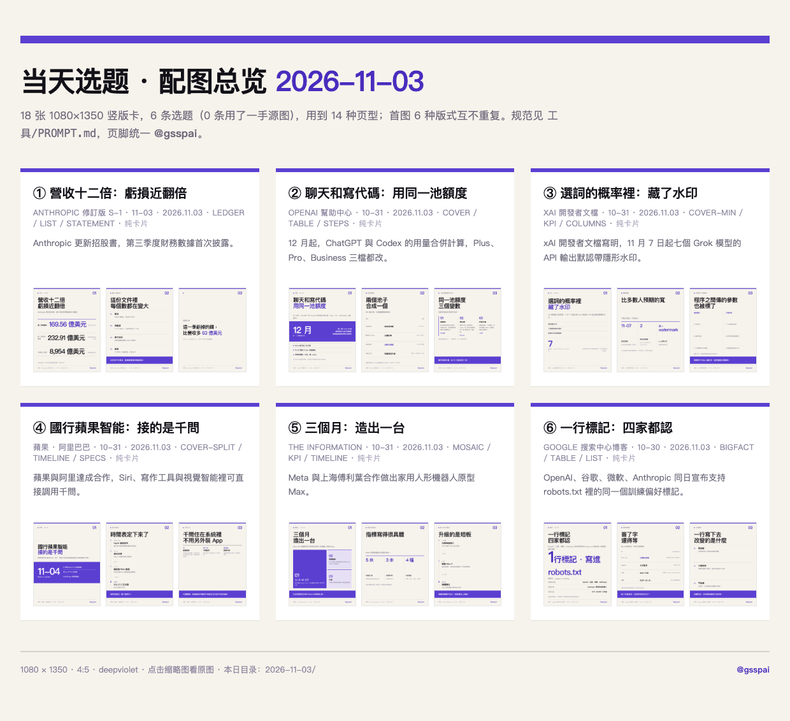

# EveryNews

把每天的 AI 新闻做成能发的图文包：六条选题，每条三张 1080×1350 竖版卡，配好 X 主帖、Threads 文案、事实表和两篇讲解长文，最后压成一个拿到网址就能开的单文件网页。



## 它能做什么

跑一轮出稿，你会得到：

| 产物 | 说明 |
|---|---|
| 18 张竖版卡 | 六条选题 × 三张，14 种版式，六套首图自动查重不撞版 |
| X 主帖 + Threads 文案 | 每条 120–200 字，繁体中文，零冒号零破折号 |
| 事实表 | 每条一表，时间、主体、数字、来源、未确认边界逐行写清 |
| 讲解长文 | 两篇 600–900 字，读完能照做 |
| 单文件公开页 | 图片全部内联，一个 HTML 文件扔到任何静态托管就能访问 |

## 为什么用它

- **规则驱动，风格稳定**。写什么、怎么写、交出什么，全部写在一份规则表里，谁跑都是同一个味道。
- **闸门质检**。字数区间、冒号破折号、翻案腔、来源层级、版式查重自动校验，不过闸门出不了稿。
- **一条命令出稿，一条命令出公开页**。渲染、归档、台账、复审回执、交接文档一次跑完。
- **纯本地运行**。node + python + playwright，没有云端依赖，产出归你自己。

## 快速开始

前置：node 20+、python3、playwright-cli（卡片截图渲染用）。

```bash
git clone https://github.com/<你的用户名>/EveryNews.git
cd EveryNews

# 出一轮当天的稿（渲染、闸门、归档、交接一次跑完）
./出稿.sh <YYYY-MM-DD> <slug...>

# 把当天产出压成单文件公开页
node 工具/make-public.mjs <YYYY-MM-DD>   # 不给日期就取最新一期
```

生成 `<YYYYMMDD>.html`，图片内联、CSS 内联，5 MB 左右，单文件拿走就能开。

## 放到自己的 GitHub Pages

仓库推上去之后，进 Settings → Pages → Source 选 `Deploy from a branch`（main / root），链接就是：

```
https://<你的用户名>.github.io/<仓库名>/YYYYMMDD.html
```

在线示例：<https://shuishui313.github.io/EveryNews/20261103.html>

每天跑完出稿和 make-public，push 一次就是新一期。

## 改成你自己的

写法规则在 `WRITING.md`，卡片版式在 `工具/PROMPT.md`，来源层级在 `SOURCES.md`，文风本体在 `human-writing/`。改掉这几份，同一条流水线不挑题材，产出的就是你自己的栏目。

## 目录

- `WRITING.md` — 写什么、怎么写、交出什么，唯一规则表
- `SHORTNEWS-V1.md` — 短文六阶段的先后顺序
- `SOURCES.md` — 去哪找、哪一级能引用
- `工具/PROMPT.md` — 配图版式与渲染
- `工具/render.mjs` — 卡片渲染（1080×1350）
- `工具/review.py` — 出稿闸门与复审回执
- `工具/grab.sh` — 一手源配图抓取
- `工具/preview.mjs` · `工具/make-preview.py` — 本地总览页与整页缩略图
- `工具/site.mjs` — 多期归档静态站
- `工具/make-public.mjs` — 单文件公开页生成
- `human-writing/` — 文风本体
- `选题台账.md` — 每期选题与实际数据回写

## 授权

MIT
